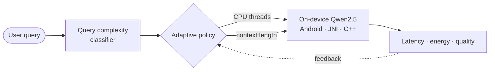

<!-- Profile README for github.com/geeky-rish -->

  
  
  

I build **data pipelines, backend systems and efficient AI**, and I measure all of it.

> [!TIP]
> Open to collaborating on open-source, data engineering and AI systems projects.

<table>
<tr>
<td width="50%" valign="top">

**🔭 Building now**
- **DataForge**: data pipeline orchestration
- **AssetSense**: predictive maintenance
- **AdaptiLLM**: adaptive on-device inference

</td>
<td width="50%" valign="top">

**🌱 Exploring**
- Spark-based ETL
- LLM quantization and edge inference
- Model deployment and MLOps
- Distributed systems

</td>
</tr>
</table>

---

## ⚡ Live from GitHub

Refreshed every 6 hours by a GitHub Action in this repo. No third-party servers.

**Latest activity**

<!-- ACTIVITY:START -->
- ⬆️ Pushed to [DailyForge](https://github.com/geeky-rish/DailyForge) (`main`) · 18 Oct 2026
- 🔀 Merged PR #6 in [Labs](https://github.com/cloud-devops-kletech/Labs) · 18 Oct 2026
- 🔀 Opened PR #6 in [Labs](https://github.com/cloud-devops-kletech/Labs) · 18 Oct 2026
- ⬆️ Pushed to [Rishi-Kulkarni-ml-zoomcamp-2026](https://github.com/geeky-rish/Rishi-Kulkarni-ml-zoomcamp-2026) (`main`) · 16 Oct 2026
- ⬆️ Pushed to [profile](https://github.com/geeky-rish/profile) (`main`) · 14 Oct 2026
<!-- ACTIVITY:END -->

---

## 🚀 Featured projects

<table>
<tr>
<td width="50%" valign="top">

### ⚙️ DataForge
Data pipeline orchestration platform: dataset ingestion, Spark transformations, validation and async job execution.

`FastAPI` `Apache Spark` `MinIO` `PostgreSQL` `Docker`

- Reusable ETL workflows
- Schema enforcement and validation
- Object storage with metadata tracking
- Containerized service orchestration

</td>
<td width="50%" valign="top">

### 📡 AssetSense
Industrial monitoring that turns real-time sensor telemetry into anomaly alerts and equipment health scores.

`ESP32` `C++` `MQTT` `Node.js` `MongoDB` `React`

- Vibration, temperature and current sensing
- Anomaly detection and health scoring
- Remaining Useful Life (RUL) prediction
- Live telemetry dashboard

</td>
</tr>
<tr>
<td width="50%" valign="top">

### 🧠 AdaptiLLM
On-device LLM inference that adapts its execution settings to query complexity and device constraints.

`Android` `Kotlin` `C++` `JNI` `TFLite` `Qwen2.5`

- Adaptive CPU threads and context length
- Query classification for workload profiling
- Latency, energy and quality-aware policies
- Evaluated across 720 inference runs

</td>
<td width="50%" valign="top">

### 🔬 Research
Practical machine learning, reinforcement learning and resource-aware AI.

`Reinforcement Learning` `Time-Series` `LLM Optimization`

- Dynamic pricing with reinforcement learning
- Efficient on-device model execution
- Data-driven system performance evaluation

</td>
</tr>
</table>

<b>How AdaptiLLM adapts (diagram)</b>

---

## 🏆 Recognition

  
  

- 🥇 **Best Paper Award, ComSIA 2026 (Springer)**: first author of *Reinforcement Learning for Dynamic Pricing*
- 🌍 **Global Public Rank 15**: WiDS Datathon Challenge 2024

---

## 🛠️ Stack

<table>
<tr><td><b>Languages</b></td><td>

</td></tr>
<tr><td><b>AI / ML / Data</b></td><td>

</td></tr>
<tr><td><b>Backend / DB</b></td><td>

</td></tr>
<tr><td><b>Cloud / DevOps</b></td><td>

</td></tr>
<tr><td><b>Edge / Embedded</b></td><td>

</td></tr>
</table>

---

## 👥 Community

<table>
<tr>
<td width="50%" valign="top">

**☁️ AWS Student Builder Groups**: Chapter Lead
- Hands-on workshops on EC2, S3, Lambda and serverless
- Mentored 50+ students through real AWS deployments

</td>
<td width="50%" valign="top">

**🌐 Google Student Ambassador**
- Represented Google developer programs on campus
- Organized technical learning activities

</td>
</tr>
</table>

---

## 📊 Stats

Generated as static SVGs by a GitHub Action and committed to this repo, so they never depend on a third-party server at view time.

  <picture>
    <source media="(prefers-color-scheme: dark)" srcset="https://raw.githubusercontent.com/geeky-rish/geeky-rish/main/profile-summary-card-output/github_dark/3-stats.svg">
    
  </picture>
  <picture>
    <source media="(prefers-color-scheme: dark)" srcset="https://raw.githubusercontent.com/geeky-rish/geeky-rish/main/profile-summary-card-output/github_dark/2-most-commit-language.svg">
    
  </picture>

  <picture>
    <source media="(prefers-color-scheme: dark)" srcset="https://raw.githubusercontent.com/geeky-rish/geeky-rish/main/profile-summary-card-output/github_dark/0-profile-details.svg">
    
  </picture>
  <picture>
    <source media="(prefers-color-scheme: dark)" srcset="https://raw.githubusercontent.com/geeky-rish/geeky-rish/main/profile-summary-card-output/github_dark/1-repos-per-language.svg">
    
  </picture>

  <picture>
    <source media="(prefers-color-scheme: dark)" srcset="https://raw.githubusercontent.com/geeky-rish/geeky-rish/output/github-contribution-grid-snake-dark.svg">
    <source media="(prefers-color-scheme: light)" srcset="https://raw.githubusercontent.com/geeky-rish/geeky-rish/output/github-contribution-grid-snake.svg">
    
  </picture>

  <i>Build it. Measure it. Improve it.</i>

